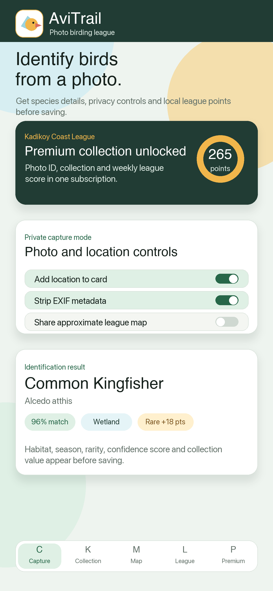
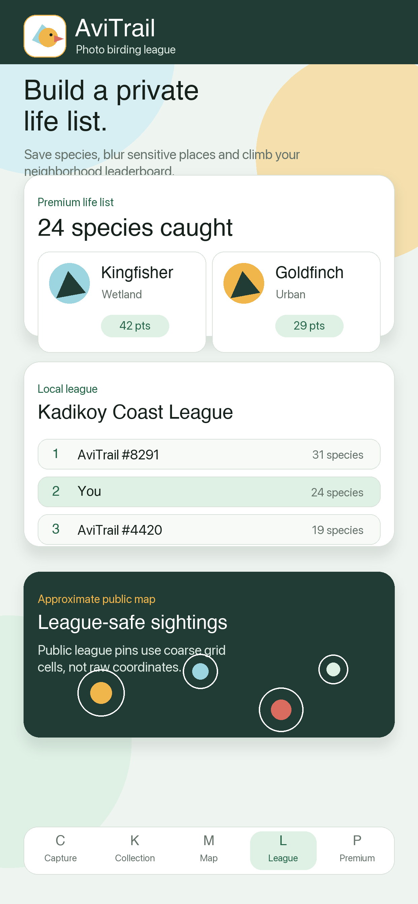
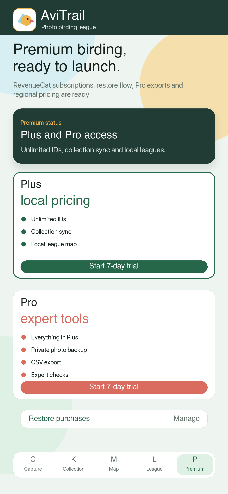

  # Bird Identifier: AviTrail

  **Identify birds by photo or sound, build your field collection, and climb local leagues.**

  
  
  
  

## Product at a glance

| | |
| --- | --- |
| **Discovery** | Suggest a species from a photo or short sound recording. |
| **Collection** | Turn sightings into field cards with names, habitat, season, rarity and confidence. |
| **Progress** | Track unique species, nearby discoveries and local league standing. |
| **Responsibility** | Remove EXIF, approximate locations and protect sensitive species on maps. |

## The experience

1. **Observe** — take a photo or capture a short bird call.
2. **Identify** — review the suggested species and contextual details.
3. **Collect** — save the sighting as a personal field card.
4. **Explore** — find nearby species and follow league progress.

## Highlights

- Photo- and audio-based bird identification
- Localized common and scientific species names
- Habitat, season, rarity and confidence context
- Personal life list with collectible field cards
- Precise-location controls and EXIF removal
- Sensitive-species protection for shared league maps
- Regional App Store pricing and purchase restoration
- 16 localized languages

## App Store preview

<table>
  <tr>
    <td width="33%"></td>
    <td width="33%"></td>
    <td width="33%"></td>
  </tr>
</table>

## Türkçe

Kuş Tanıma: AviTrail; kuşları fotoğraf veya sesle tanımaya, gözlemleri koleksiyon kartları olarak saklamaya ve yerel liglerde ilerlemeye yardımcı olur. Konum hassasiyeti ayarı, EXIF temizleme ve hassas tür koruması ile sorumlu gözlem paylaşımını destekler.

## Links

- [App Store](https://apps.apple.com/us/app/avitrail/id6793438480)
- [Product website](https://avitrail-6793438480.web.app/)

© 2026 AviTrail. All rights reserved.
