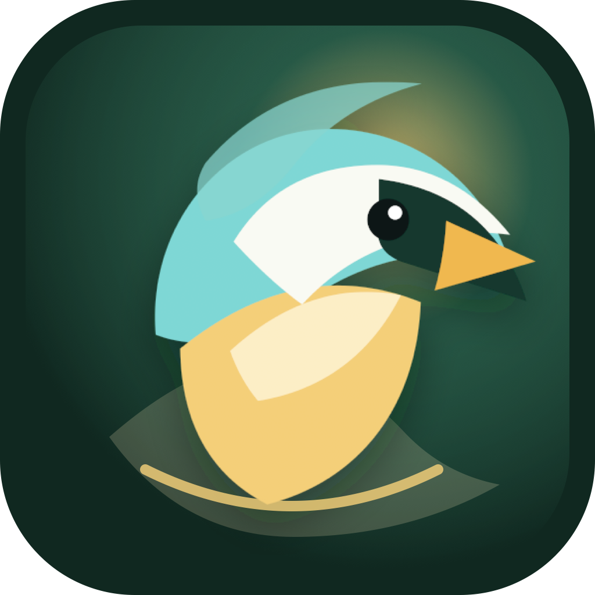

  

  # AviTrail: Bird Identifier

  **Identify birds by photo or sound, build your private field collection, and climb local leagues.**

  

## Your birding trail, beautifully collected

AviTrail turns every sighting into a field card. Take or choose a photo, record a bird call, and get a suggested species with its localized name, scientific name, habitat, season, rarity, and confidence score. Keep the discoveries you love in a personal collection and follow your progress over time.

## What you can do

- Identify birds from a photo or a short sound recording.
- Save sightings as collectible field cards.
- Protect sensitive locations with EXIF removal and approximate-location controls.
- Join local leagues and compare unique-species progress.
- Discover nearby species that are still missing from your collection.
- Restore purchases and use regional App Store pricing.
- Use AviTrail in 16 localized languages.

## Privacy-aware birdwatching

Nature should be shared responsibly. AviTrail gives you control over whether a location is saved, keeps precise coordinates out of public league data, and prevents sensitive species from appearing on public league maps.

## App Store preview

<table>
  <tr>
    <td width="33%"></td>
    <td width="33%"></td>
    <td width="33%"></td>
  </tr>
</table>

## Türkçe

AviTrail; kuşları fotoğraf veya sesle tanımanıza, gözlemlerinizi özel koleksiyon kartları olarak saklamanıza ve yerel liglerde ilerlemenize yardımcı olan bir iPhone uygulamasıdır. Konum gizliliği, EXIF temizleme ve hassas tür koruması sayesinde doğa gözlemlerinizi daha güvenli biçimde kaydedebilirsiniz.

## Links

- [Download AviTrail on the App Store](https://apps.apple.com/us/app/avitrail/id6793438480)
- [Product website](https://avitrail-6793438480.web.app/)
- [Support](https://avitrail-6793438480.web.app/support.html)
- [Privacy Policy](https://sites.google.com/view/avitrail-privacy-policy)
- [Terms of Use](https://sites.google.com/view/avitrail-terms-of-use)

## About this repository

This public repository contains AviTrail product information and official App Store media. The application source code and operational configuration are maintained in a separate private repository.

© 2026 Arda Özen. All rights reserved.
